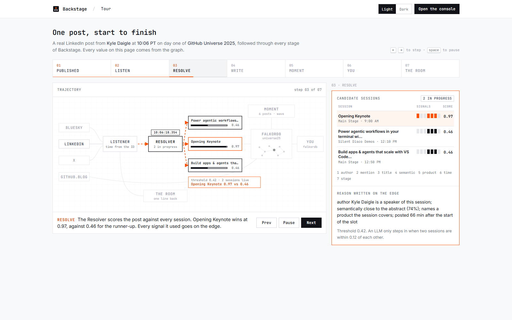
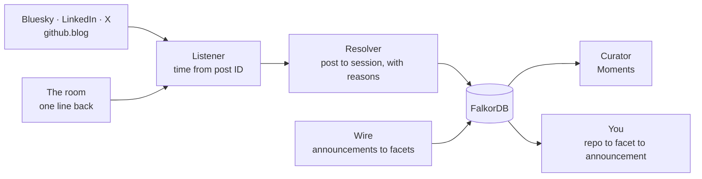
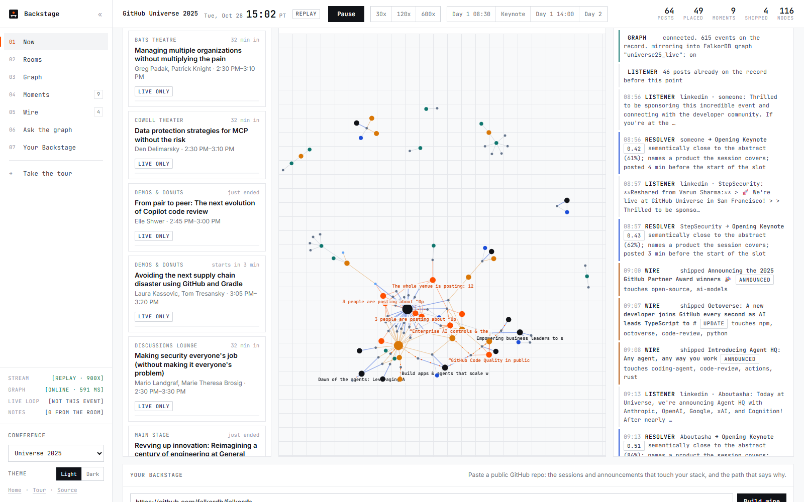
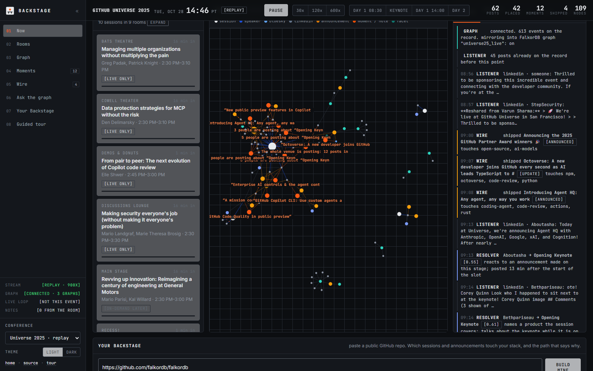

<p align="center">
  <picture>
    <source media="(prefers-color-scheme: dark)" srcset="app/static/docs/logo-dark.svg">
    
  </picture>
</p>

<h1 align="center">Backstage</h1>

<p align="center"><b>The live layer for everyone who is not in the room.</b><br>
The public record of a conference, resolved to the agenda as it happens, in a graph you can question.</p>

<p align="center">
  <a href="https://backstage-live.fly.dev">Live site</a> &nbsp;·&nbsp;
  <a href="https://backstage-live.fly.dev/tour">Tour</a> &nbsp;·&nbsp;
  <a href="https://backstage-live.fly.dev/console?play=keynote&speed=120">Replay GitHub Universe 2025</a> &nbsp;·&nbsp;
  <a href="#how-it-works">How it works</a> &nbsp;·&nbsp;
  <a href="#run-locally">Run locally</a>
</p>

<p align="center">
  <a href="https://github.com/elsisiem/backstage/actions/workflows/ci.yml"></a>
  
  
</p>

<p align="center"></p>

## Why

A conference runs eight rooms at once. Most people who care about it are not there, and the ones who are sit in one room while seven others run without them. Organizers are cutting livestreams because they cost too much, speakers are missing events over visas, and recordings arrive weeks later with no index. Meanwhile the whole day is narrated in public, on Bluesky, LinkedIn and X, by the people in the room.

Backstage reads that record as it is written, places every post on the session it is about, and keeps the result in FalkorDB. From the graph it answers the questions people outside the room actually have: which room is loud right now, what just shipped that touches my code, and which ten minutes did I miss.

## Try it

| Page | What it shows |
|---|---|
| [Landing](https://backstage-live.fly.dev) | The problem, the pipeline, and a Moment from the real record |
| [Tour](https://backstage-live.fly.dev/tour) | One real post followed through all seven stages, autoplaying, with the evidence for each step |
| [Console](https://backstage-live.fly.dev/console?play=keynote&speed=120) | GitHub Universe 2025 replayed minute by minute while the graph builds itself |

The tour follows Kyle Daigle's LinkedIn post at 10:06 PT on day one. It shows the timestamp decoded from the post ID, the three sessions it was scored against, the edge written into FalkorDB, the six-post Moment it fed, and the two hops from the FalkorDB repository to that morning's announcements.

## How it works



Four agents share one graph.

| Agent | Writes | How |
|---|---|---|
| Listener | `Post`, `Author` | Discovery through Exa and Bright Data. Exact timestamps decoded from the platform's own post IDs |
| Resolver | `Post -ABOUT_SESSION {confidence, reason, signals}-> Session` | Seven signals it can explain: the author is a speaker, names a speaker, quotes the title, is close to the abstract, names a product the talk covers, landed inside the slot, reacts to something said on stage. An LLM only breaks ties between two close candidates |
| Wire | `Announcement -AFFECTS-> Facet` | Changelog and launch posts with exact publish times, tagged by the parts of a stack they touch |
| Curator | `Moment -OF-> Session`, `Moment -EVIDENCE-> Post` | Spikes in one room, waves after an announcement, surges across the venue |

The agenda goes in as `Conference → Day → Session → Room / Speaker / Track / Product / Facet`, with `Session -OVERLAPS- Session` computed inside the graph as the conflict map (718 pairs for Universe 2025). A repository enters as `Repo -USES-> Facet`, so "what touches my stack" is a two-hop path, and "why is this post here" is `Post -BY-> Author -IS-> Speaker <-PRESENTED_BY- Session`.

### Timestamps without an API

Discovery returns a date and no time of day. Bluesky record keys are TIDs: microseconds since the epoch in sortable base32. LinkedIn activity IDs carry the millisecond in their top 41 bits. Backstage decodes both, so the replay is the real minute-by-minute day. Checked against a live Bluesky record, the decode matches to the millisecond.

### Sponsor stack

**FalkorDB** is the product, not storage. One graph per conference; every edge carries the evidence that created it; the console's detail panel, the tour's read-back and the Ask tab are all Cypher against it. During a replay every event is also written into a second graph, `<conference>_live`, so the graph is visibly built during a demo. Free-form questions compile to read-only Cypher, run, and get repaired if they error or come back empty.

**Bright Data** covers what a plain fetch cannot reach. The GitHub Universe catalog is a RainFocus JavaScript app with no documented endpoint. Bluesky's public API returns 403 to ordinary networks. X has no affordable read API. Backstage uses the SERP API to discover X posts with date operators, the Browser API over CDP to read Bluesky, and the Web Scraper X dataset where the account has it enabled. Every response is cached by request hash, so a re-run never spends twice.

## The console

<p align="center"></p>

- **Right now across the venue.** One card that summarizes every room before you look at any of them.
- **Rooms.** Live only or on demand later, straight from the catalog, with public signal from the last thirty minutes.
- **The graph.** Builds itself as the day unfolds. Click any node for the path behind it. Expand to full screen.
- **Agents, Moments, Wire, Ask.** The log is the agents' reasoning, Moments and Wire are their output, Ask turns questions into Cypher.
- **Your Backstage.** Paste a public repository: its manifests become facets, and facets reach sessions and announcements.
- **Report from the room.** One sentence from inside, no account, delivered to every open console.

Light and dark themes, keyboard control (`space`, `esc`, `?`), and demo links such as `/console?play=keynote&speed=120` and `/tour?step=3`.

<p align="center"></p>

## Run locally

Requirements: Python 3.12 and a FalkorDB instance (Docker is the quickest way to get one).

```bash
python -m venv .venv && . .venv/bin/activate        # Windows: .venv\Scripts\activate
pip install -r requirements.txt
cp .env.example .env                                # FalkorDB, OpenAI, Bright Data, Exa
docker run -p 6379:6379 falkordb/falkordb:v4.22.2   # or any hosted FalkorDB

python -m app.ingest.rainfocus universe25 universe26   # agenda: 151 and 157 sessions
python -m scripts.build_timeline universe25            # resolve posts, curate Moments, load FalkorDB, write the replay
python -m scripts.build_story universe25               # the tour's story, computed from the graph
python -m app.server                                   # http://localhost:8080
```

While a live-mode conference is inside its dates, the server pulls new posts every three minutes, resolves them with the same agents and appends them to the timeline and the graph. GitHub Universe 2026 is loaded and armed for 28 October.

CI runs `ruff check .` and `python -m compileall -q app scripts`. There is no test suite.

## Configuration

Set variables in `.env` (copy `.env.example`). Every variable has a default or a fallback.

| Variable | Required | Purpose |
|---|---|---|
| `FALKORDB_HOST` | No | FalkorDB host. Default `127.0.0.1`. |
| `FALKORDB_PORT` | No | FalkorDB port. Default `6379`. |
| `FALKORDB_PASSWORD` | No | FalkorDB password. Default none. |
| `OPENAI_API_KEY` | No | Resolver tie-breaks, embeddings and free-form Ask. Without it the Resolver runs on its deterministic signals and free-form questions are off. |
| `OPENAI_MODEL` | No | Chat model. Default `gpt-5-mini`. |
| `OPENAI_EMBED_MODEL` | No | Embedding model. Default `text-embedding-3-small`. |
| `BRIGHTDATA_API_KEY` | No | Bright Data account key for the SERP API, Web Unlocker and Web Scraper. Without Bright Data, discovery runs on Exa alone. |
| `BRIGHTDATA_UNLOCKER_ZONE` | No | Web Unlocker zone. Default `web_unlocker1`. |
| `BRIGHTDATA_SERP_ZONE` | No | SERP API zone. Default `serp_api1`. |
| `BRIGHTDATA_CUSTOMER` | No | Customer ID for the zone-password route, an alternative to the account key. |
| `BRIGHTDATA_SERP_PASSWORD` | No | SERP zone password (proxy mode). |
| `BRIGHTDATA_BROWSER_PASSWORD` | No | Browser API zone password (Bluesky and blocked pages over CDP). |
| `BRIGHTDATA_BROWSER_ZONE` | No | Browser API zone. Default `web_unlocker1`. |
| `EXA_API_KEY` | No | Post discovery through Exa. |
| `BACKSTAGE_LIVE` | No | Set to `0` to turn off the background live pull. Default `1`. |
| `PORT` | No | Port for `python -m app.server`. Default `8080`. |

## Deploy

The live site is two Fly.io apps in `sjc`: FalkorDB with a volume (`infra/falkor/fly.toml`) and the app (`fly.toml`, which points `FALKORDB_HOST` at `backstage-falkor.internal`).

The Dockerfile copies `data/cache/rainfocus`, and `data/cache/` is git-ignored. Run the RainFocus ingest locally first (`python -m app.ingest.rainfocus universe25 universe26`, see Run locally). The Docker build copies its cache, so a fresh clone fails to build without it.

```bash
fly apps create backstage-falkor
fly volumes create falkor_data --size 1 --region sjc -a backstage-falkor
fly deploy -c infra/falkor/fly.toml -a backstage-falkor

fly apps create backstage-live
fly secrets set OPENAI_API_KEY="<key>" BRIGHTDATA_API_KEY="<key>" EXA_API_KEY="<key>" -a backstage-live
fly deploy -a backstage-live
```

The hosted FalkorDB starts empty. Load a conference into it by running the build steps from Run locally with `FALKORDB_HOST` and `FALKORDB_PORT` pointing at it, for example through `fly proxy 6379:6379 -a backstage-falkor`.

## Project layout

| Path | What |
|---|---|
| `app/ingest/rainfocus.py` | RainFocus catalog API to sessions and speakers |
| `app/ingest/posts.py` | Post normalization and timestamp recovery from post IDs |
| `app/ingest/brightdata.py` | SERP discovery, Browser API, X posts dataset |
| `app/ingest/githubblog.py` | Announcements with exact publish times and facets |
| `app/agents/resolver.py` | Post to session, speaker and announcement, with reasons |
| `app/agents/curator.py` | Moments |
| `app/agents/live.py` | Live pull for a conference that is happening now |
| `app/graph.py` | FalkorDB schema, batched writes, path queries |
| `app/server.py` | FastAPI: replay stream mirrored into a live graph; why, session, ask, repo, note and story endpoints |
| `app/static/` | Landing, tour and console; one stylesheet, self-hosted fonts |
| `scripts/` | Timeline and story builds |
| `data/timeline/` | Replay timelines and the tour story, committed |
| `infra/falkor/fly.toml` | The hosted FalkorDB app |
| `DEMO.md` | The three-minute demo script |

## Status

- Discovery is search over the public web, so recall is partial, and a relevance filter drops posts that are not about the conference.
- Resolution is only as good as its signals. Confidence and reason sit on every edge, so a wrong placement is visible rather than silent.
- Small conferences are sparse. Backstage is strongest from a few hundred attendees up.
- The posts in `data/timeline/` are public posts captured for the replay: 286 for GitHub Universe 2025 (282 from LinkedIn, 4 from Bluesky, none from X). The 2026 timeline is empty until the event.
- The live site has no authentication. `/api/conf/{id}/ask` and `/api/conf/{id}/live/pull` spend API credits on every call (OpenAI, Exa, Bright Data), so they are rate limited per client along with room reports: 10 questions, 2 pulls and 5 reports per minute. The limits live in memory, so they reset on restart and are not shared between instances. The background live loop is not subject to them.
- There is no automated test suite. CI runs ruff and a compile check.

## Credits

Built in one day at Patch the Conference, San Francisco, 24 October 2026, with FalkorDB, Bright Data and Exa.

## License

MIT. See [LICENSE](LICENSE).
